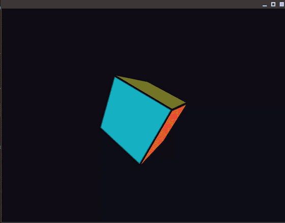

# lgpu

[](https://crates.io/crates/lgpu)
[](https://docs.rs/lgpu)
[](https://github.com/kuntal-devrat/lgpu/actions/workflows/ci.yml)
[](LICENSE-MIT)

A lightweight Vulkan 1.3 wrapper for Rust and C99, built on top of [`ash`](https://github.com/ash-rs/ash).

`lgpu` is designed for local desktop graphics experiments where you want modern Vulkan features—dynamic rendering and bindless descriptor indexing—without the verbosity of raw Vulkan boilerplate or the compile overhead of large multi-backend frameworks.

<p align="center">
  
</p>

---

## What is lgpu?

- **Vulkan 1.3 only**: Uses dynamic rendering (`VK_KHR_dynamic_rendering`) directly. No `VkRenderPass` or `VkFramebuffer` state boilerplate.
- **Bindless indexing**: Global descriptor heaps (`update_after_bind`) for uniform/storage buffers, sampled textures, storage images, and samplers. Resources are indexed by integer IDs in shaders.
- **Fast compile times**: Depends only on `ash`, `bitflags`, `thiserror`, and `raw-window-handle`. Clean builds typically take 1–2 seconds.
- **Simple suballocator**: Built-in block allocator for small buffers and textures to stay well clear of driver allocation limits.
- **C99 FFI**: Includes [`lgpu.h`](crates/lgpu-c/include/lgpu.h) to use the library from C, C++, or Zig without Rust in your main application.

### What lgpu is NOT

- **Not a `wgpu` replacement**: `wgpu` is an implementation of WebGPU targeting multiple backends (Metal, D3D12, Vulkan, WebGL) with shader translation and validation via `naga`. `lgpu` targets Vulkan 1.3 exclusively and expects precompiled SPIR-V shaders.
- **Not a fully safe sandbox**: While `lgpu` provides RAII and safe wrapper structs where reasonable, Vulkan synchronization and shader indexing still require you to know how modern GPUs work.

For a detailed technical breakdown of how `lgpu` compares to `wgpu`, `vulkano`, and `kvark/blade`, along with thread safety (`Send`/`Sync`), CPU buffer mapping invariants, and synchronization rules, see **[Architecture, Safety & Synchronization Model](docs/ARCHITECTURE_AND_SAFETY.md)**.

---

## Workspace

- **[`crates/lgpu`](crates/lgpu)**: High-level Rust API with RAII handles for devices, buffers, textures, pipelines, and command encoders.
- **[`crates/lgpu-hal`](crates/lgpu-hal)**: Lower-level Vulkan 1.3 layer handling instance setup, memory suballocation, bindless descriptor sets, and swapchain presentation.
- **[`crates/lgpu-c`](crates/lgpu-c)**: C99 bindings and shared library export.
- **[`examples/`](examples)**: Runnable examples demonstrating compute, clear screen, bindless rendering, particle simulation, and windowed graphics.

---

## Platform Support

| Platform | Windowing / Surface | Vulkan Driver |
| :--- | :--- | :--- |
| **Linux** | Wayland / X11 (`winit` / `raw-window-handle`) | Mesa (`RADV`, `ANV`, `NVK`), NVIDIA proprietary |
| **Windows** | Win32 (`HWND` / `HINSTANCE`) | Standard vendor Vulkan runtime (`vulkan-1.dll`) |
| **macOS** | Metal (`CAMetalLayer` via MoltenVK) | MoltenVK (`libMoltenVK.dylib`) |

*Requires a GPU / driver supporting Vulkan 1.3 and dynamic rendering.*

---

## Quick Start

### Rust

Add `lgpu` to your `Cargo.toml`:

```toml
[dependencies]
lgpu = "0.1.3"
bytemuck = { version = "1.19", features = ["derive"] }
```

#### Headless Compute Example

```rust,no_run
use lgpu::{BufferDesc, BufferUsage, MemoryLocation};

fn main() -> Result<(), Box<dyn std::error::Error>> {
    // Initialize primary GPU in one line (or use Instance::new() for custom device selection)
    let (device, queue) = lgpu::default_device()?;

    // Create host-visible buffers
    let desc = BufferDesc {
        label: Some("DataBuffer"),
        size: 16,
        usage: BufferUsage::STORAGE | BufferUsage::TRANSFER_SRC | BufferUsage::TRANSFER_DST,
        memory_location: MemoryLocation::CpuToGpu,
    };
    let input = device.create_buffer_init_slice(&desc, &[1.0f32, 2.0, 3.0, 4.0])?;
    let output = device.create_buffer(&desc)?;

    // Create compute pipeline from precompiled SPIR-V
    let shader = device.create_shader_spirv(include_bytes!("../path/to/compute.spv"))?;
    let pipeline = device.create_compute_pipeline(&shader, 2)?;

    // Record and run work (submits and waits synchronously)
    let mut encoder = device.create_command_encoder()?;
    encoder.dispatch_compute(&pipeline, &[&input, &output], 1, 1, 1);
    queue.run(encoder)?;

    // Read back results
    let mut results = [0.0f32; 4];
    output.read(bytemuck::cast_slice_mut(&mut results))?;
    println!("GPU Results: {:?}", results);

    Ok(())
}
```

---

### C99

Include [`lgpu.h`](crates/lgpu-c/include/lgpu.h):

```c
#include <stdio.h>
#include <lgpu.h>

int main(void) {
    lgpu_instance_t instance = NULL;
    if (lgpu_create_instance(&instance) != LGPU_SUCCESS) {
        fprintf(stderr, "Failed to create Vulkan instance\n");
        return 1;
    }

    uint32_t count = lgpu_get_adapter_count(instance);
    printf("Found %u GPU(s)\n", count);

    lgpu_device_t device = NULL;
    lgpu_queue_t queue = NULL;
    if (lgpu_create_device(instance, 0, &device, &queue) == LGPU_SUCCESS) {
        // ... record and submit work ...
        lgpu_destroy_device(device);
        lgpu_destroy_queue(queue);
    }

    lgpu_destroy_instance(instance);
    return 0;
}
```

Build and run the polyglot examples:

```bash
# C99 Example
make -C examples/c_example run

# C++17 Example (RAII handles, GPU-to-GPU buffer copies)
make -C examples/cpp_example run

# Zig Example (C-import, buffer allocation & verification)
make -C examples/zig_example run
```

---

## Examples

Run any of the included examples:

```bash
# Headless compute dispatch (vector addition)
cargo run -p example-headless-compute

# Clear screen with dynamic rendering
cargo run -p example-clear-screen

# Bindless triangle (no vertex buffer, generated in shader)
cargo run -p example-bindless-triangle

# Particle simulation with compute & dynamic rendering
cargo run -p example-bindless-100k

# Interactive window with 3D torus raymarched shader
cargo run --release -p example-window-shader

# Real-time voxel raymarching engine (Minecraft-style translucent water, procedural mountains, caustics, floating islands)
cargo run --release -p example-voxel-renderer

# C99, C++17, and Zig examples via single-header include/lgpu.h
make -C examples/c_example run
make -C examples/cpp_example run
make -C examples/zig_example run
```

---

## Running Tests

```bash
# Run unit & hardware integration tests
cargo test --workspace

# Run doc tests
cargo test --doc

# Run clippy
cargo clippy --workspace --all-targets --all-features
```

---

## License

Dual-licensed under either:

- MIT License ([LICENSE-MIT](LICENSE-MIT))
- Apache License, Version 2.0 ([LICENSE-APACHE](LICENSE-APACHE))

at your option.
