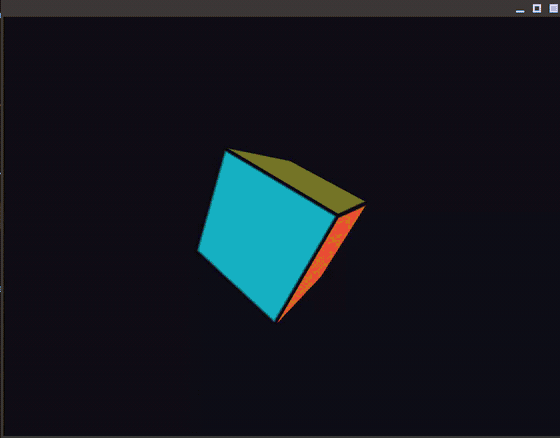

# lgpu

[](https://crates.io/crates/lgpu)
[](https://docs.rs/lgpu)
[](https://github.com/kuntal-devrat/lgpu/actions/workflows/ci.yml)
[](LICENSE-MIT)

A small Vulkan 1.3 wrapper for Rust and C99, built on [`ash`](https://github.com/ash-rs/ash).

lgpu is meant for desktop graphics work that needs dynamic rendering and bindless
descriptor indexing without the boilerplate of raw Vulkan or the build cost of a
multi-backend framework.

<p align="center">
  
</p>

## What it provides

- Vulkan 1.3 with dynamic rendering (`VK_KHR_dynamic_rendering`). No `VkRenderPass` or
  `VkFramebuffer` objects to manage.
- Global bindless descriptor heaps (`update_after_bind`) for storage buffers, sampled
  textures, storage images and samplers. Shaders address resources by integer ID.
- A block suballocator for buffers and textures so small resources do not each take a
  driver allocation.
- Optional WGSL to SPIR-V compilation at runtime through Naga, behind the `wgsl` feature.
- A C99 header, [`lgpu.h`](crates/lgpu-c/include/lgpu.h), for use from C, C++ or Zig.

The dependency set is `ash`, `bitflags`, `thiserror`, `raw-window-handle` (plus Naga when
the `wgsl` feature is on), so clean builds finish in a second or two.

## Scope

lgpu is not a wgpu replacement. wgpu implements WebGPU across Metal, D3D12, Vulkan and
the web, translates shaders with Naga, and validates GPU state at runtime. lgpu targets
Vulkan 1.3 only and expects precompiled SPIR-V.

lgpu is also not a safety sandbox. Handles use RAII and host memory access is bounds
checked, but GPU synchronization and shader resource indexing are left to the caller. A
shader that indexes past a bindless heap will fault the device on most drivers.

[Architecture, Safety and Synchronization Model](docs/ARCHITECTURE_AND_SAFETY.md) covers
thread safety, mapped memory rules, lock ordering and the synchronization model.

## Workspace

- [`crates/lgpu`](crates/lgpu): high-level Rust API with handles for devices, buffers,
  textures, pipelines and command encoders.
- [`crates/lgpu-hal`](crates/lgpu-hal): lower layer that owns Vulkan instance setup, the
  memory suballocator, bindless heaps and swapchain presentation.
- [`crates/lgpu-c`](crates/lgpu-c): C99 bindings and shared library export.
- [`examples/`](examples): compute, clear screen, bindless rendering, particle and
  windowed programs.

## Platform support

| Platform | Windowing / surface | Vulkan driver |
| :--- | :--- | :--- |
| Linux | Wayland or X11 (`winit` / `raw-window-handle`) | Mesa (RADV, ANV, NVK), NVIDIA proprietary |
| Windows | Win32 (`HWND` / `HINSTANCE`) | Vendor Vulkan runtime (`vulkan-1.dll`) |
| macOS | Metal (`CAMetalLayer` via MoltenVK) | MoltenVK (`libMoltenVK.dylib`) |

A Vulkan 1.3 driver with dynamic rendering is required.

## Quick start

### Rust

Add lgpu to `Cargo.toml`:

```toml
[dependencies]
lgpu = "0.1.6"
bytemuck = { version = "1.19", features = ["derive"] }
```

#### Headless compute example

```rust,no_run
use lgpu::{BufferDesc, BufferUsage, MemoryLocation};

fn main() -> Result<(), Box<dyn std::error::Error>> {
    // Initializes a default instance and picks the first GPU. Use Instance::new()
    // when you need to choose a specific device.
    let (device, queue) = lgpu::default_device()?;

    // Create host-visible buffers
    let desc = BufferDesc {
        label: Some("DataBuffer"),
        size: 16,
        usage: BufferUsage::STORAGE | BufferUsage::TRANSFER_SRC | BufferUsage::TRANSFER_DST,
        memory_location: MemoryLocation::CpuToGpu,
    };
    let input = device.create_buffer_init_slice(&desc, &[1.0f32, 2.0, 3.0, 4.0])?;
    let output = device.create_buffer(&desc)?;

    // Create compute pipeline from precompiled SPIR-V
    let shader = device.create_shader_spirv(include_bytes!("../path/to/compute.spv"))?;
    let pipeline = device.create_compute_pipeline(&shader, 2)?;

    // Record and run work (submits and waits synchronously)
    let mut encoder = device.create_command_encoder()?;
    encoder.dispatch_compute(&pipeline, &[&input, &output], 1, 1, 1);
    queue.run(encoder)?;

    // Read back results
    let mut results = [0.0f32; 4];
    output.read(bytemuck::cast_slice_mut(&mut results))?;
    println!("GPU Results: {:?}", results);

    Ok(())
}
```

### C99

Include [`lgpu.h`](crates/lgpu-c/include/lgpu.h):

```c
#include <stdio.h>
#include <lgpu.h>

int main(void) {
    lgpu_instance_t instance = NULL;
    if (lgpu_create_instance(&instance) != LGPU_SUCCESS) {
        fprintf(stderr, "Failed to create Vulkan instance\n");
        return 1;
    }

    uint32_t count = lgpu_get_adapter_count(instance);
    printf("Found %u GPU(s)\n", count);

    lgpu_device_t device = NULL;
    lgpu_queue_t queue = NULL;
    if (lgpu_create_device(instance, 0, &device, &queue) == LGPU_SUCCESS) {
        // ... record and submit work ...
        lgpu_destroy_device(device);
        lgpu_destroy_queue(queue);
    }

    lgpu_destroy_instance(instance);
    return 0;
}
```

Build and run the C, C++ and Zig examples, which use the same header:

```bash
make -C examples/c_example run
make -C examples/cpp_example run
make -C examples/zig_example run
```

## Examples

```bash
# Headless compute dispatch (vector addition)
cargo run -p example-headless-compute

# Clear screen with dynamic rendering
cargo run -p example-clear-screen

# Bindless triangle (no vertex buffer, generated in the shader)
cargo run -p example-bindless-triangle

# Particle simulation with compute and dynamic rendering
cargo run -p example-bindless-100k

# Interactive window with a raymarched torus shader
cargo run --release -p example-window-shader

# Voxel raymarching engine with terrain, water and caustics
cargo run --release -p example-voxel-renderer
```

## Running tests

```bash
# Unit and hardware integration tests
cargo test --workspace

# Doc tests
cargo test --doc

# Lints
cargo clippy --workspace --all-targets --all-features
```

The integration tests skip themselves when no Vulkan 1.3 device is available.

## License

Dual-licensed under either:

- MIT License ([LICENSE-MIT](LICENSE-MIT))
- Apache License, Version 2.0 ([LICENSE-APACHE](LICENSE-APACHE))

at your option.
