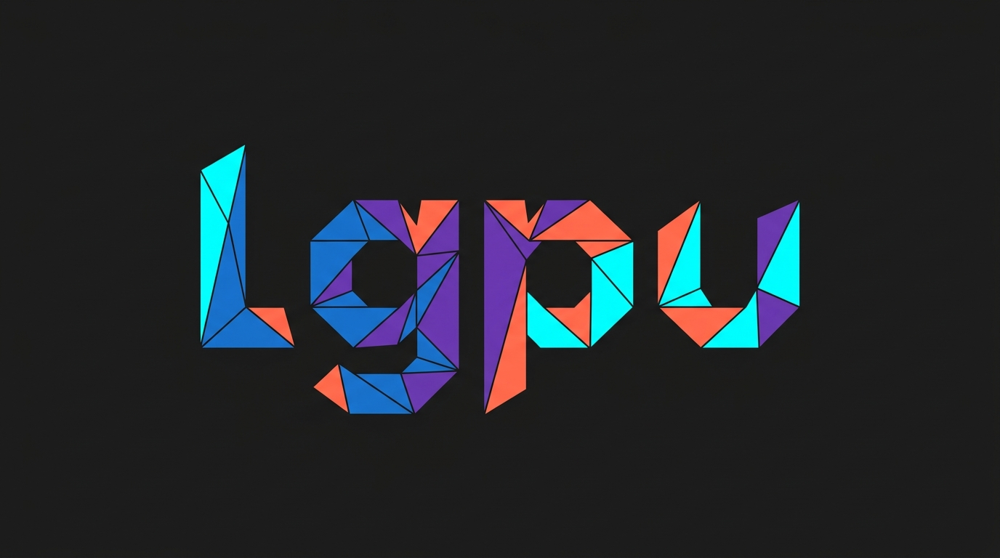

<p align="center">
  
</p>

# lgpu

`lgpu` is a lightweight GPU library written in Rust with C bindings. It provides a direct, minimal abstraction over modern GPU APIs, focusing on bindless descriptor indexing, dynamic rendering, and explicit resource management.

## Features

- **Bindless by Design**: Unbounded descriptor indexing for buffers and textures.
- **Modern Rendering**: Uses Vulkan 1.3 dynamic rendering without legacy render pass objects.
- **Compute & Graphics**: Unified pipelines for compute dispatches and graphics draw calls.
- **Memory Suballocator**: Built-in suballocation for efficient buffer allocations and recycling.
- **Synchronization**: Support for timeline semaphores, memory barriers, and multi-buffered frame submission.
- **C FFI (`lgpu-c`)**: C99-compatible header (`include/lgpu.h`) for integration with C, C++, and other languages.
- **Dynamic Loading**: Dynamically loads Vulkan at runtime without requiring static SDK linkage.

## Architecture

The project is structured into three crates:

- **`lgpu`**: The high-level, safe Rust API.
- **`lgpu-hal`**: Low-level hardware abstraction layer managing dynamic driver loading and Vulkan objects.
- **`lgpu-c`**: C-compatible FFI wrapper and C header definitions.

## Quick Start (Rust)

A minimal headless compute example dispatching a kernel and reading back results:

```rust
use lgpu::{BufferDesc, BufferUsage, Instance, MemoryLocation};

fn main() -> Result<(), Box<dyn std::error::Error>> {
    let instance = Instance::new()?;
    let adapters = instance.enumerate_adapters()?;
    let (device, queue) = adapters[0].request_device(&instance)?;

    let desc = BufferDesc {
        label: Some("ComputeBuffer"),
        size: 256,
        usage: BufferUsage::STORAGE | BufferUsage::TRANSFER_SRC | BufferUsage::TRANSFER_DST,
        memory_location: MemoryLocation::CpuToGpu,
    };

    let buf_a = device.create_buffer_init_slice(&desc, &[1.0f32, 2.0, 3.0, 4.0])?;
    let buf_b = device.create_buffer_init_slice(&desc, &[10.0f32, 20.0, 30.0, 40.0])?;
    let buf_c = device.create_buffer(&desc)?;

    let shader = device.create_shader_spirv(VECTOR_ADD_SPV)?;
    let pipeline = device.create_compute_pipeline(&shader, 3)?;

    let mut encoder = device.create_command_encoder()?;
    encoder.dispatch_compute(&pipeline, &[&buf_a, &buf_b, &buf_c], 1, 1, 1);
    queue.submit(encoder.finish())?;

    let mut results = [0.0f32; 4];
    buf_c.read(bytemuck::cast_slice_mut(&mut results))?;
    println!("Output: {:?}", results);

    Ok(())
}
```

## Running Examples

The repository includes several examples demonstrating various capabilities:

```bash
# Headless compute (vector addition)
cargo run -p example-headless-compute

# Clear screen using dynamic rendering
cargo run -p example-clear-screen

# Triangle rendering with bindless resources
cargo run -p example-bindless-triangle

# Particle simulation with 100,000 instances
cargo run -p example-bindless-100k

# Windowed rendering with multiple shader modes
cargo run -p example-window-shader
```

### Running C Examples

To build and run the C example:

```bash
cargo build -p lgpu-c
gcc -std=c99 examples/c_example/main.c -Icrates/lgpu-c/include -Ltarget/debug -llgpu_c -Wl,-rpath,$(pwd)/target/debug -o c_example
./c_example
```

## Running Tests

Run the test suite across all crates:

```bash
cargo test --all
cargo test --doc
```

## License

Licensed under either of:

- Apache License, Version 2.0 ([LICENSE-APACHE](LICENSE-APACHE))
- MIT License ([LICENSE-MIT](LICENSE-MIT))

at your option.
